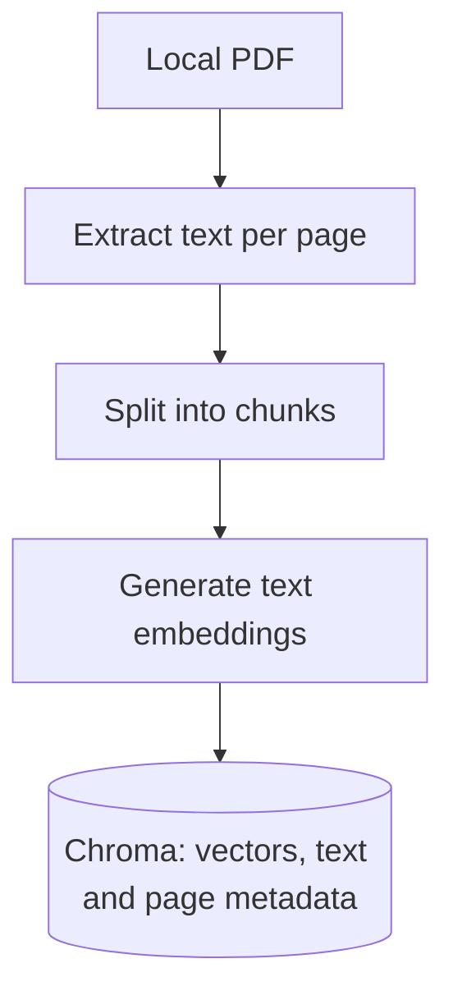
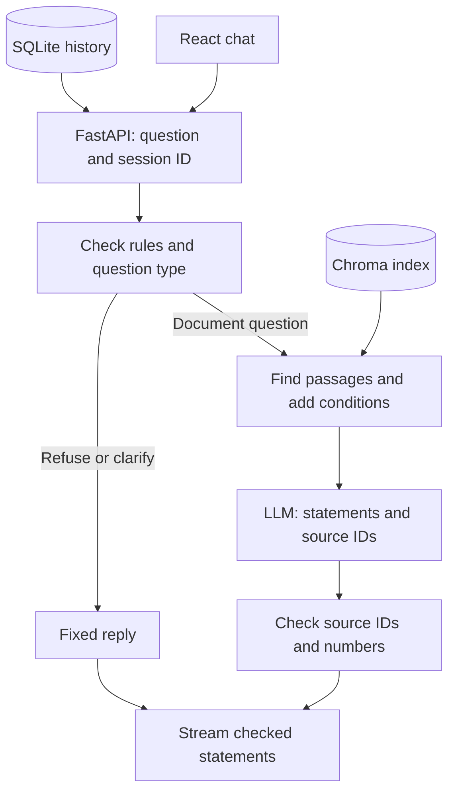

# InsureTutor

A bilingual insurance tutor for the supplied **FLEXI-ULife Prime Saver** brochure.
Ask questions in English, Simplified Chinese or Traditional Chinese, follow up
in the same conversation, and click the numbered references beside each
statement to see the original passage and open the PDF at that page.

Built with React/TypeScript, FastAPI, Chroma, and OpenAI chat and embedding models.


## Quick start with Docker

Requires Docker with Compose and an OpenAI API key.

```sh
cp .env.example .env
# Edit .env and set MODEL_API_KEY to your OpenAI API key.
docker compose up --build
```

- Chat: <http://localhost:5173>
- API docs: <http://localhost:8000/docs>
- Setup status: <http://localhost:8000/api/health>

On the first start, the backend reads the PDF, splits its text into chunks,
creates vectors and saves them in Chroma. Later starts reuse this index if the
PDF and settings have not changed. If the page shows
"Unable to connect" while the backend is still starting, refresh it. After
changing `.env`, run `docker compose up -d --force-recreate backend`.

Try:

- "Is the 4% interest rate guaranteed?"
- "停止缴付保费会怎样？"
- "保單冷靜期有多久？從何時開始計算？"
- "What is the minimum increase or decrease in sum insured?"
- "What is the guaranteed account value?" → "And when does it apply?"

The language selector controls the interface and replies. You can override the
answer language by asking for another language in your question.

**Where data goes.** The API key stays on the backend. PDFs, extracted text, vectors
and conversations are stored locally. OpenAI receives document text during
embedding, and questions with retrieved passages during answering.

## Local development

Use Python 3.11+ and Node 22.12+ or Node 24. From the repository root:

```sh
python3 -m venv .venv
source .venv/bin/activate
pip install -r backend/requirements.txt
cp .env.example .env  # then set MODEL_API_KEY
uvicorn app.main:app --app-dir backend --reload --port 8000
```

In a second terminal:

```sh
cd frontend
npm ci
npm run dev
```

Vite forwards `/api` requests to the backend on port 8000. Environment variables
already set in the terminal override values in `.env`.

To rebuild the index manually:

```sh
PYTHONPATH=backend .venv/bin/python -m app.rag.ingest --force
# Docker: docker compose exec backend python -m app.rag.ingest --force
```

Rebuilding creates a new Chroma collection. The app switches to it only after
all chunks are stored, so a failed rebuild keeps the old index available.
At startup, the backend rebuilds if the PDFs, chunk settings or embedding
settings have changed. Use `--force` after changing extraction or splitting code.

To use other source files, replace the PDFs in `data/raw/` and restart the
backend. The interface lists documents from the active index. Some answer
instructions and the bilingual amount-conflict check are specific to this
brochure; review them and add test questions before using another product.

## Architecture

**1. Prepare the documents** — at startup, build or reuse the saved index.



**2. Answer a question** — runs for each chat message. The model returns
statements with source IDs; the code calls each statement a **claim**.



**Code structure**

```text
backend/app/
├── main.py          API endpoints, PDF serving and startup indexing
├── chat.py          Loads history and runs the question-to-answer flow
├── guardrails.py    Checks question type, misuse, sources and numbers
├── model_client.py  Provider calls and embeddings
├── storage.py       SQLite conversation history
├── config.py        Environment settings
├── schemas.py       Typed page, chunk, chat and model-output records
└── rag/
    ├── ingest.py    load_pdf → split_pages → build_index (offline)
    └── query.py     load_index → retrieve → answer_question (online)
frontend/src/        React chat, SSE reader, language selector and inline citations
backend/tests/       Unit and API tests that make no network calls
evals/               End-to-end cases, retrieval parameter sweep and results
data/raw/            Source PDF (index, extracted text and sessions are generated and ignored)
```

An editable diagram is in [docs/architecture.drawio](docs/architecture.drawio).

## Key design decisions

- **Link answers to pages.** Keep each chunk on one PDF page so citations open
  the right page.
- **Search in two ways.** Combine meaning and keyword matches, then include
  related conditions from the PDF.
- **Check cited facts.** Check source IDs and numbers before showing an answer.
  This cannot confirm that the answer interprets the text correctly.
- **Handle unsuitable questions.** Ask when a question is unclear. Refuse
  personal advice, unrelated requests and attempts to bypass the rules. Say
  when the PDF does not provide enough evidence.
- **Keep chat and documents separate.** Chroma stores searchable PDF chunks;
  SQLite saves questions and final answers. Use the last three turns to
  understand follow-up questions.

See [design decisions](docs/design-decisions.md) for alternatives, parameters
and tradeoffs.

## Configuration

| Variable | Default | Purpose |
|---|---|---|
| `MODEL_API_KEY` | empty | OpenAI API key; server-side only |
| `MODEL_PROVIDER` | `openai` | Model API provider |
| `MODEL_BASE_URL` | `https://api.openai.com/v1` | API base URL |
| `CHAT_MODEL` | `gpt-4.1-mini` | Answer model |
| `EMBEDDING_BACKEND` | `openai` | Vector embedding backend |
| `EMBEDDING_MODEL` | `text-embedding-3-small` | Same model for documents and queries |
| `CHUNK_SIZE` / `CHUNK_OVERLAP` | `1000` / `150` | Character splitting settings |
| `TOP_K` | `5` | Primary retrieval count (expanded context can include more) |
| `MEMORY_TURNS` | `3` | Prior completed question/answer turns (1–10) |
| `AUTO_INGEST` | `true` | Build or reuse the index on startup |
| `CHAT_MODE` | `llm` | `extractive` shows source passages without chat generation |

An optional Claude
adapter exists (`MODEL_PROVIDER=anthropic` with `EMBEDDING_BACKEND=local`, which
downloads a local embedding model and needs a full index rebuild); it is not
the tested configuration.

## Evaluation results

These recorded results use the supplied 20-page brochure and
`text-embedding-3-small`. For nine test questions, relevant PDF pages were
manually labeled. Each query retrieves five primary chunks, then repeated page
numbers are removed before scoring:

- **Page Precision@5:** relevant retrieved pages / all retrieved pages.
- **Page Recall@5:** relevant retrieved pages / all labeled relevant pages.
- **Page MRR:** average of 1 / rank of the first relevant page; higher means
  relevant pages appear earlier.

These scores measure whether retrieval finds the right pages. They do not
measure whether the final answer is correct.

### Chunk size and overlap (17 October 2026)

Keyword weight is fixed at 0.12. Sizes and overlap are in characters.

| Chunk size / overlap | Chunks | Page Precision@5 | Page Recall@5 | Page MRR |
|---|---:|---:|---:|---:|
| 600 / 0 | 72 | 0.519 | 1.000 | 0.944 |
| 600 / 90 | 79 | 0.537 | 1.000 | 0.944 |
| 1000 / 0 | 50 | 0.513 | 1.000 | **1.000** |
| **1000 / 150 (current)** | 54 | **0.541** | 1.000 | **1.000** |
| 1400 / 0 | 38 | 0.467 | 1.000 | 0.944 |
| 1400 / 210 | 38 | 0.500 | 1.000 | 0.889 |

The current setting had the highest page precision and shared the best MRR.
Using 1000-character chunks without overlap sent about 11% less source text to
the model, but had lower precision. We kept 1000/150 based on this small test;
more questions are needed to judge whether it works well more broadly.

### Keyword weight

Selected results from nine page-labeled questions:

| Keyword weight | Page Precision@5 | Page Recall@5 | Page MRR |
|---|---:|---:|---:|
| 0 (vector only) | 0.578 | 0.944 | 1.000 |
| **0.12 (current)** | 0.541 | **1.000** | **1.000** |
| 1.0 | 0.448 | **1.000** | **1.000** |

Keyword scoring recovered a page missed by vector-only search; too much keyword
weight added irrelevant pages. We kept 0.12 after checking live answers. See
the [full comparison](evals/retrieval_results.md).

### Application checks

| Check | Recorded result | What it checks |
|---|---|---|
| Backend tests with mocked models | 134 passed (21 October 2026) | Extraction, indexing, retrieval, guardrails, sessions and streaming |
| Frontend tests | 17 passed (8 October 2026) | SSE parsing, cancellation, final-answer replacement and citation links |
| Live end-to-end smoke cases | 28 / 28 passed in one full run (15 October 2026) | Response status, expected source pages, selected phrases/numbers and empty citations for refusals |

One concrete example from each type:

| Type | What the test supplies | What must happen to pass |
|---|---|---|
| [Backend](backend/tests/test_guardrails.py) | A test passage says "21 days"; a deliberately wrong answer says "99 days" and cites that passage. | The answer checker raises an error because 99 is absent from the cited text. |
| [Frontend](frontend/tests/frontend.test.mjs) | A simulated server sends a Chinese answer and its final result one byte at a time. | The stream reader reconstructs the original answer without breaking Chinese characters. |
| [Real API](evals/questions.jsonl) | Ask "Is the 4% interest rate guaranteed?" through the running backend. | Status is `answered`, the answer contains `4%` and `not guaranteed`, and at least one citation points to PDF page 8 or 16. |

An earlier Simplified Chinese overview returned `insufficient_evidence`, then
passed three reruns. See the [verification record](docs/verification.md).

### Reproduce the checks

```sh
.venv/bin/pip install -r backend/requirements-dev.txt
.venv/bin/python -m pytest backend/tests -q
(cd frontend && npm run build && npm test)
```

With the backend running (this calls the configured model API):

```sh
.venv/bin/python evals/run_eval.py         # 30 end-to-end cases
.venv/bin/python evals/retrieval_sweep.py  # chunk-setting comparison
.venv/bin/python evals/lexical_weight_sweep.py  # keyword-weight comparison
```

The end-to-end cases include policy conditions, follow-ups, three languages,
missing information, conflicting amounts and misuse. The scripts save detailed
reports locally under `evals/results/`.

## Limits

- Scanned PDFs are not supported, and table text may be read in the wrong order.
- Citations and number checks cannot confirm that the answer explains a policy condition correctly.
- This demo is designed for a small document collection and local use. It does not include user login or request limits.
