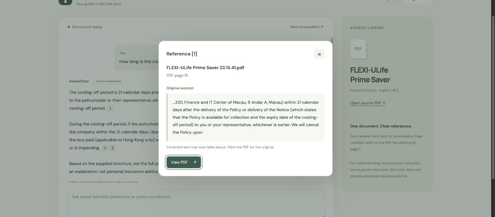
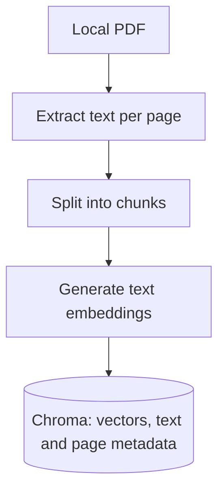

# InsureTutor

A bilingual insurance tutor for the supplied **FLEXI-ULife Prime Saver** brochure.
Ask questions in English, Simplified Chinese or Traditional Chinese, follow up
in the same conversation, and click the numbered references beside each
statement to see the original passage and open the PDF at that page.

Built with React/TypeScript, FastAPI, Chroma, and OpenAI chat and embedding models.



## Quick start with Docker

Requires Docker with Compose and an OpenAI API key.

```sh
cp .env.example .env
# Edit .env and set MODEL_API_KEY to your OpenAI API key.
docker compose up --build
```

- Chat: <http://localhost:5173>
- API docs: <http://localhost:8000/docs>
- Setup status: <http://localhost:8000/api/health>

On the first start, the backend reads the PDF, splits its text into chunks,
creates vectors and saves them in Chroma. Later starts reuse this index if the
PDF and settings have not changed. If the page shows
"Unable to connect" while the backend is still starting, refresh it. After
changing `.env`, run `docker compose up -d --force-recreate backend`.

Try:

- "Is the 4% interest rate guaranteed?"
- "停止缴付保费会怎样？"
- "保單冷靜期有多久？從何時開始計算？"
- "What is the minimum increase or decrease in sum insured?"
- "What is the guaranteed account value?" → "And when does it apply?"

The language selector controls the interface and replies. You can override the
answer language by asking for another language in your question.

**Where data goes.** The API key stays on the backend. PDFs, extracted text, vectors
and conversations are stored locally. OpenAI receives document text during
embedding, and questions with retrieved passages during answering.

## Local development

Use Python 3.11+ and Node 22.12+ or Node 24. From the repository root:

```sh
python3 -m venv .venv
source .venv/bin/activate
pip install -r backend/requirements.txt
cp .env.example .env  # then set MODEL_API_KEY
uvicorn app.main:app --app-dir backend --reload --port 8000
```

In a second terminal:

```sh
cd frontend
npm ci
npm run dev
```

Vite forwards `/api` requests to the backend on port 8000. Environment variables
already set in the terminal override values in `.env`.

To rebuild the index manually:

```sh
PYTHONPATH=backend .venv/bin/python -m app.rag.ingest --force
# Docker: docker compose exec backend python -m app.rag.ingest --force
```

Rebuilding creates a new Chroma collection. The app switches to it only after
all chunks are stored, so a failed rebuild keeps the old index available.
At startup, the backend rebuilds if the PDFs, chunk settings or embedding
settings have changed. Use `--force` after changing extraction or splitting code.

To use other source files, replace the PDFs in `data/raw/` and restart the
backend. The interface lists documents from the active index. Some answer
instructions and the bilingual amount-conflict check are specific to this
brochure; review them and add test questions before using another product.

## Architecture

**1. Prepare the documents** — at startup, build or reuse the saved index.



**2. Answer a question** — runs for each chat message. The model returns
statements with source IDs; the code calls each statement a **claim**.


The backend checks each completed statement before sending it to the frontend
through SSE (Server-Sent Events). The frontend shows each update as it arrives,
then replaces the preview with the final answer. The question and final answer
are saved in SQLite; clarification replies are also saved. If answer checks
fail, the model gets one chance to correct its output. If that also fails,
the user receives an insufficient-evidence reply.

**Code structure**

```text
backend/app/
├── main.py          API endpoints, PDF serving and startup indexing
├── chat.py          Loads history and runs the question-to-answer flow
├── guardrails.py    Checks question type, misuse, sources and numbers
├── model_client.py  Provider calls and embeddings
├── storage.py       SQLite conversation history
├── config.py        Environment settings
├── schemas.py       Typed page, chunk, chat and model-output records
└── rag/
    ├── ingest.py    load_pdf → split_pages → build_index (offline)
    └── query.py     load_index → retrieve → answer_question (online)
frontend/src/        React chat, SSE reader, language selector and inline citations
backend/tests/       Unit and API tests that make no network calls
evals/               End-to-end cases, retrieval parameter sweep and results
data/raw/            Source PDF (index, extracted text and sessions are generated and ignored)
```

Each claim contains answer text and 1–4 source chunk IDs selected by the model.
The backend builds the numbered references and PDF links from those sources.
Here, "claim" means an answer statement, not an insurance claim (理赔申请).

An editable diagram is in [docs/architecture.drawio](docs/architecture.drawio).

## Key design decisions

- **Keep page numbers.** Chunks stay within one PDF page so users can open the
  exact source page for an answer.
- **Search by meaning and keywords.** Use both scores to rank chunks, then add
  text from matching pages and disclosures so benefit conditions are included.
- **Check before showing.** Require a source ID for each answer statement.
  Check that the ID was retrieved and its passage contains the stated numbers.
  This catches fake references and unsupported numbers, but can still miss
  a wrong interpretation of the text.
- **Decide which questions to answer.** Block common attempts to override rules
  or invent facts, refuse personal advice and unrelated topics, and ask for
  clarification when needed. For document questions, retrieve first; if evidence
  is insufficient, say so.
- **Store documents and chat separately.** Chroma stores vectors, text and page
  details; SQLite stores full chat messages. Read the last three saved turns by
  default to understand follow-ups, but use newly retrieved passages for facts.

See [design decisions](docs/design-decisions.md) for alternatives, parameters
and tradeoffs.

## Important details in this brochure

The brochure is general reference, **not the full policy contract**.

- PDF page 8 quotes assumed rates as of **January 2022**; the tutor does not
  present them as current or guaranteed.
- The 2.5% condition concerns accumulated account value after at least 15
  years in force, not a guaranteed annual credited rate.
- On PDF page 17 the minimum increase/decrease in sum insured reads
  USD 5,000 / HKD 40,000 / MOP 400,000 in Chinese and
  USD 5,000 / HKD 400,000 / MOP 40,000 in English. The tutor reports the
  discrepancy instead of choosing one.
- The brochure has no claim document list or processing time, so the tutor
  answers those questions with insufficient evidence.

## Configuration

| Variable | Default | Purpose |
|---|---|---|
| `MODEL_API_KEY` | empty | OpenAI API key; server-side only |
| `MODEL_PROVIDER` | `openai` | Model API provider |
| `MODEL_BASE_URL` | `https://api.openai.com/v1` | API base URL |
| `CHAT_MODEL` | `gpt-4.1-mini` | Answer model |
| `EMBEDDING_BACKEND` | `openai` | Vector embedding backend |
| `EMBEDDING_MODEL` | `text-embedding-3-small` | Same model for documents and queries |
| `CHUNK_SIZE` / `CHUNK_OVERLAP` | `1000` / `150` | Character splitting settings |
| `TOP_K` | `5` | Primary retrieval count (expanded context can include more) |
| `MEMORY_TURNS` | `3` | Prior completed question/answer turns (1–10) |
| `AUTO_INGEST` | `true` | Build or reuse the index on startup |
| `CHAT_MODE` | `llm` | `extractive` shows source passages without chat generation |

An optional Claude
adapter exists (`MODEL_PROVIDER=anthropic` with `EMBEDDING_BACKEND=local`, which
downloads a local embedding model and needs a full index rebuild); it is not
the tested configuration.

## Evaluation results

These recorded results use the supplied 20-page brochure and
`text-embedding-3-small`. For nine test questions, relevant PDF pages were
manually labeled. Each query retrieves five primary chunks, then repeated page
numbers are removed before scoring:

- **Page Precision@5:** relevant retrieved pages / all retrieved pages.
- **Page Recall@5:** relevant retrieved pages / all labeled relevant pages.
- **Page MRR:** average of 1 / rank of the first relevant page; higher means
  relevant pages appear earlier.

These scores measure whether retrieval finds the right pages. They do not
measure whether the final answer is correct.

### Chunk size and overlap (7 October 2026)

Keyword weight is fixed at 0.12. Sizes and overlap are in characters.

| Chunk size / overlap | Chunks | Page Precision@5 | Page Recall@5 | Page MRR |
|---|---:|---:|---:|---:|
| 600 / 0 | 72 | 0.528 | 1.000 | 0.944 |
| 600 / 90 | 79 | 0.537 | 1.000 | 0.944 |
| 1000 / 0 | 50 | 0.513 | 1.000 | **1.000** |
| **1000 / 150 (current)** | 53 | **0.541** | 1.000 | **1.000** |
| 1400 / 0 | 37 | 0.457 | 1.000 | 0.944 |
| 1400 / 210 | 37 | 0.500 | 1.000 | 0.889 |

The current setting had the highest page precision and shared the best MRR.
Using 1000-character chunks without overlap sent about 11% less source text to
the model, but had lower precision. We kept 1000/150 based on this small test;
more questions are needed to judge whether it works well more broadly.

### Keyword weight (13 October 2026)

Chunk settings stay at 1000/150. Selected rows from the weight comparison:

| Keyword weight | Page Precision@5 | Page Recall@5 | Page MRR |
|---|---:|---:|---:|
| 0 (vector only) | 0.578 | 0.944 | 0.944 |
| 0.05 | **0.596** | **1.000** | **1.000** |
| **0.12 (current)** | 0.541 | **1.000** | **1.000** |
| 1.0 | 0.448 | **1.000** | **1.000** |

Keyword scoring found a page missed by vector-only search and put a relevant
page first for another question. Giving keywords too much weight brought in
more irrelevant pages. Weight 0.05 scored better than the current 0.12 on
precision, with the same recall and MRR. Before changing it, we need more labeled
questions and checks of the resulting answers.
See the [full retrieval comparison](evals/retrieval_results.md) for all weights
and the amount and relevance of source text sent to the model.

### Application checks (8 October 2026)

| Check | Recorded result | What it checks |
|---|---|---|
| Backend tests with mocked models | 115 passed | Extraction, indexing, retrieval, guardrails, sessions and streaming |
| Frontend tests | 17 passed | SSE parsing, cancellation, final-answer replacement and citation links |
| Live end-to-end smoke cases | 27 / 28 passed in one full run | Response status, expected source pages, selected phrases/numbers and empty citations for refusals |

One concrete example from each type:

| Type | What the test supplies | What must happen to pass |
|---|---|---|
| [Backend](backend/tests/test_guardrails.py) | A test passage says "21 days"; a deliberately wrong answer says "99 days" and cites that passage. | The answer checker raises an error because 99 is absent from the cited text. |
| [Frontend](frontend/tests/frontend.test.mjs) | A simulated server sends a Chinese answer and its final result one byte at a time. | The stream reader reconstructs the original answer without breaking Chinese characters. |
| [Real API](evals/questions.jsonl) | Ask "Is the 4% interest rate guaranteed?" through the running backend. | Status is `answered`, the answer contains `4%` and `not guaranteed`, and at least one citation points to PDF page 8 or 16. |

The first two examples use controlled test data without calling a real model.
The third calls the real model API and checks its actual response.

One Simplified Chinese overview returned `insufficient_evidence`. It passed
three reruns, but this shows the same question can sometimes fall back to a
fixed reply. These smoke checks verify expected behavior; a passing answer can
still misinterpret a condition, translation or table. Those details need manual
comparison with the PDF. See the [verification record](docs/verification.md)
for dated runs and the [evaluation guide](evals/README.md) for test cases.

### Reproduce the checks

```sh
.venv/bin/pip install -r backend/requirements-dev.txt
.venv/bin/python -m pytest backend/tests -q
(cd frontend && npm run build && npm test)
```

With the backend running (this calls the configured model API):

```sh
.venv/bin/python evals/run_eval.py         # 28 end-to-end cases
.venv/bin/python evals/retrieval_sweep.py  # chunk-setting comparison
.venv/bin/python evals/lexical_weight_sweep.py  # keyword-weight comparison
```

The end-to-end cases include policy conditions, follow-ups, three languages,
missing information, conflicting amounts and misuse. The scripts save detailed
reports locally under `evals/results/`.

## Limits

- Only PDFs with selectable text are supported. There is no OCR for scanned
  pages, and extracting tables can lose row and column relationships.
- References open the source page, without highlighting the exact paragraph.
- Source and number checks can still miss a wrong explanation of a condition.
- All chunks are scored on each query. A larger document collection needs a
  more efficient search approach.
- Session IDs are not user authentication. There are no session ownership checks
  or rate limits, and Docker runs the frontend through Vite's development server.
  This setup is intended for local use.
